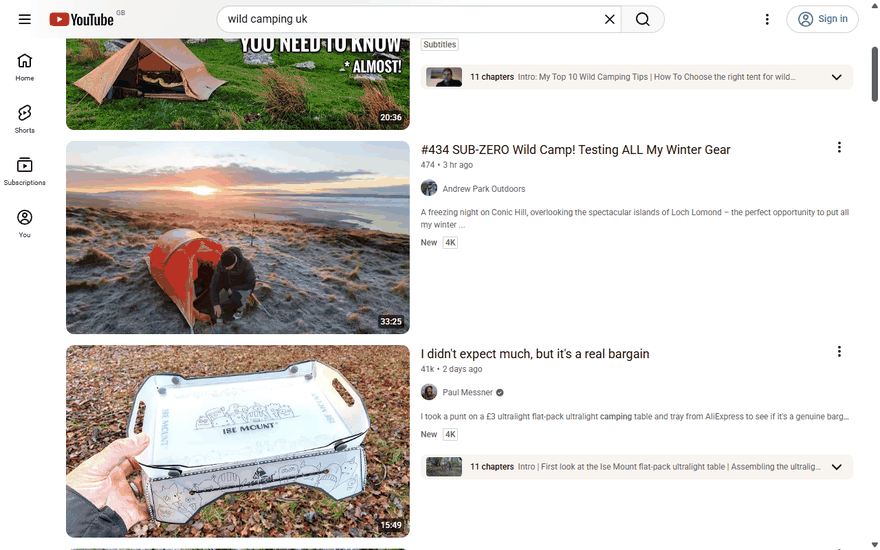
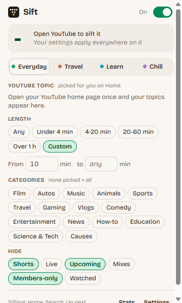
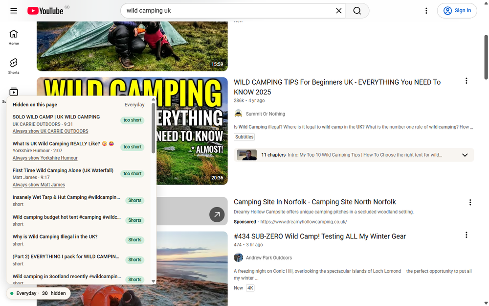
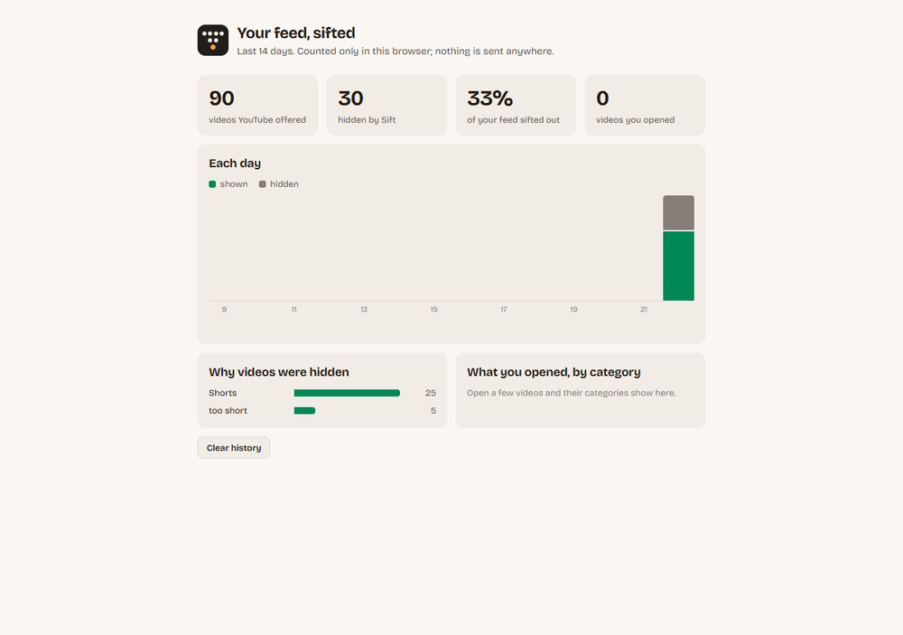

<p align="center"></p>

<h1 align="center">Sift</h1>

<p align="center">Your YouTube feed, minus the stuff you didn't come for.<br>
For Zen and Firefox.</p>

<p align="center"></p>

Sift hides videos before YouTube draws them, so there is no flicker and no
empty holes in the grid. You decide what "the stuff you didn't come for" is:

- **Length.** Only 20-60 minute videos tonight? One click.
- **Shorts, live, upcoming, members-only, mixes, already watched.**
- **YouTube's own topics.** The chips YouTube builds for you on the home page
  (Camping, Podcasts, whatever it has learned you like) show up in Sift. Pick one
  and Home opens on it every time.
- **Categories.** Travel, Education, Music and the other twelve YouTube uses.
- **Your own words.** Hide titles containing "reaction", or keep only titles
  containing "bushcraft".
- **Channels.** Never show these, always show those.

Put a set of these together and it's a **mode**. Sift comes with Everyday, Travel,
Learn and Chill, and you can make your own and switch between them from the toolbar.

## What you see

| | |
|---|---|
|  | **The popup.** How many videos were hidden on this page and why, your modes, and the knobs for the current mode. |
|  | **Why was that hidden?** The small chip in the corner of YouTube opens a list of everything Sift took out, with the reason. One click lets a channel through. |
|  | **Stats.** What YouTube offered, what you kept, what you actually opened. Counted only in your browser. |

## Install

Get the files from the [latest release](../../releases/latest).

### Zen or Firefox

1. Download `sift-<version>.xpi`.
2. Drag it onto a Zen or Firefox window (or open `about:addons`, click the gear,
   then **Install Add-on From File...**).
3. Click **Add** when the browser asks.

That's it. The file is signed by Mozilla and Sift updates itself from here
afterwards. Needs Firefox 140 or newer; any recent Zen works.

A listing on addons.mozilla.org is on its way; the link goes here once it's approved.

### Chrome, Edge, Brave, Opera, Vivaldi

Sift isn't on the Chrome Web Store, so it goes in by hand:

1. Download `sift-<version>-chrome.zip` and unzip it somewhere you'll keep it
   (the browser loads it from that folder every time it starts).
2. Open `chrome://extensions` (Edge: `edge://extensions`, Brave: `brave://extensions`).
3. Turn on **Developer mode** (top right; on Edge it's in the left sidebar).
4. Click **Load unpacked** and pick the unzipped folder, the one with `manifest.json` in it.
5. Pin Sift from the puzzle-piece menu so the icon stays in the toolbar.

Chrome may show a "developer mode extensions" notice on start-up; that's normal
for anything not from its store.

### Updates

| | How it updates |
|---|---|
| Zen, Firefox | By itself. The browser checks about once a day; to check now: `about:addons` → gear → **Check for Updates**. |
| Chrome and friends | Chrome doesn't update extensions from outside its store, so Sift tells you instead: when a new version is out, the popup shows **"Sift x.y.z is out · Get it"**. Download the new zip, unzip it over the same folder, then press the reload arrow on Sift's card in `chrome://extensions`. Your settings stay. |

### The API key is optional

Everything above works without one, **except category filtering**. YouTube doesn't
put a video's category in the feed, so without a key Sift only knows the
categories of videos you have opened. With your own free key it asks YouTube
directly, once per video. The key stays in your browser and is only ever sent to
YouTube. Settings explains how to get one in about five minutes.

## Privacy

No account, no analytics, no server of ours. Settings, history and the category
cache live in your browser's extension storage. The only network request Sift
makes itself is to YouTube's API, with your key, if you add one.

## Building it

```
npm install
npm run check     # types, tests, build, Mozilla's linter
npm run build     # dist/firefox (main) and dist/chrome
```

Load `dist/firefox/manifest.json` from `about:debugging` to try a change. The
tests run against real YouTube page data saved in `test/fixtures`; when YouTube
changes its format, save a fresh page there and the tests show what broke.

How it works, briefly: a script runs in the YouTube page before YouTube's own
code, catches the feed data as it arrives (the first page and every request
after it) and removes what your rules say to remove. Anything it doesn't
recognise is left alone, so a YouTube change can make Sift miss things but
never hide your whole feed.

## License

Copyright (c) 2026 zerobun. All rights reserved. The source is public so you can
read it and see exactly what the extension does; it is not open source. See
[LICENSE](LICENSE). The bundled font, Bricolage Grotesque, is under the SIL Open
Font License.
